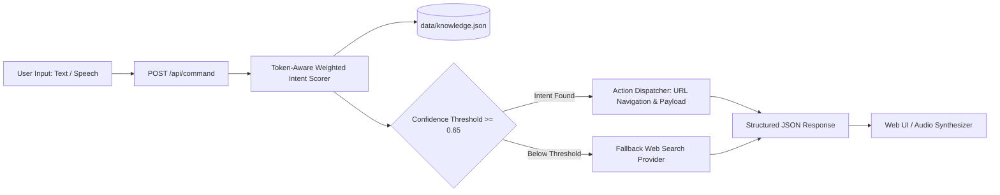

# 🎙️ Nexus AI — Intent-Based NLP Virtual Assistant & Natural Language Automation Engine

[](https://www.python.org/)
[](https://flask.palletsprojects.com/)
[](https://en.wikipedia.org/wiki/Natural_language_processing)
[](LICENSE)

Nexus AI is an intelligent natural language command processor and automation engine built in Python and Flask. It uses a token-aware, weighted intent scoring system against structured JSON knowledge bases to accurately classify user intents, synthesize conversational audio responses, and dispatch automated desktop or web actions (e.g. YouTube playback, Google searches, system commands).

---

## ⚡ Core Capabilities

- **Token-Aware Weighted Matching**: Calculates semantic intent confidence scores across pattern tokens, penalizing unrelated noise words.
- **Dynamic Knowledge Base**: Easily extensible JSON architecture (`data/knowledge.json`) supporting runtime updates without server restarts.
- **Multi-Service Action Routing**: Intelligently routes queries to targeted search providers (YouTube, Google, GitHub, Maps) with URL encoding.
- **RESTful API & Responsive Web GUI**: Exposes `/api/command` for headless client integration alongside an intuitive browser interface.
- **Audio & Speech Synthesis Ready**: Formatted responses engineered for browser speech synthesis (`SpeechSynthesisUtterance`) and desktop text-to-speech engines.

---

## 🏛️ System Architecture



---

## 🛠️ Tech Stack

- **Backend**: Python 3.10+, Flask
- **Data Model**: Python `dataclasses`, `json`, `pathlib`, `urllib.parse`
- **Frontend**: HTML5, Modern CSS, Vanilla JavaScript, Web Speech API

---

## 🚀 Quickstart & Setup

### 1. Clone & Navigate
```bash
git clone https://github.com/uniqabhishek/Python-Project.git
cd Python-Project/python/"project 2"
```

### 2. Install Dependencies
```bash
pip install -r requirements.txt
```

### 3. Run the Assistant
```bash
python app.py
```
Open your browser at `http://localhost:5000` to interact with the Nexus AI console.

---

## 👨‍💻 Author

**Abhishek**  
- GitHub: [@uniqabhishek](https://github.com/uniqabhishek)  
- Portfolio / Flagship App: [TradeMind AI](https://uniqabhishek.github.io/Trading-Journal/)
